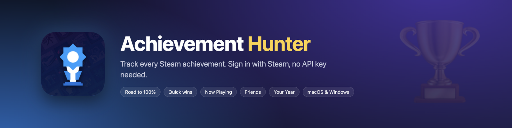
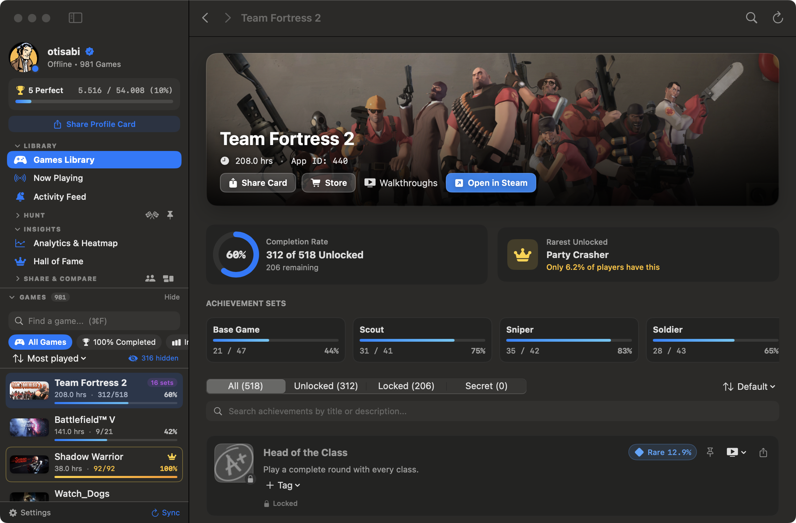
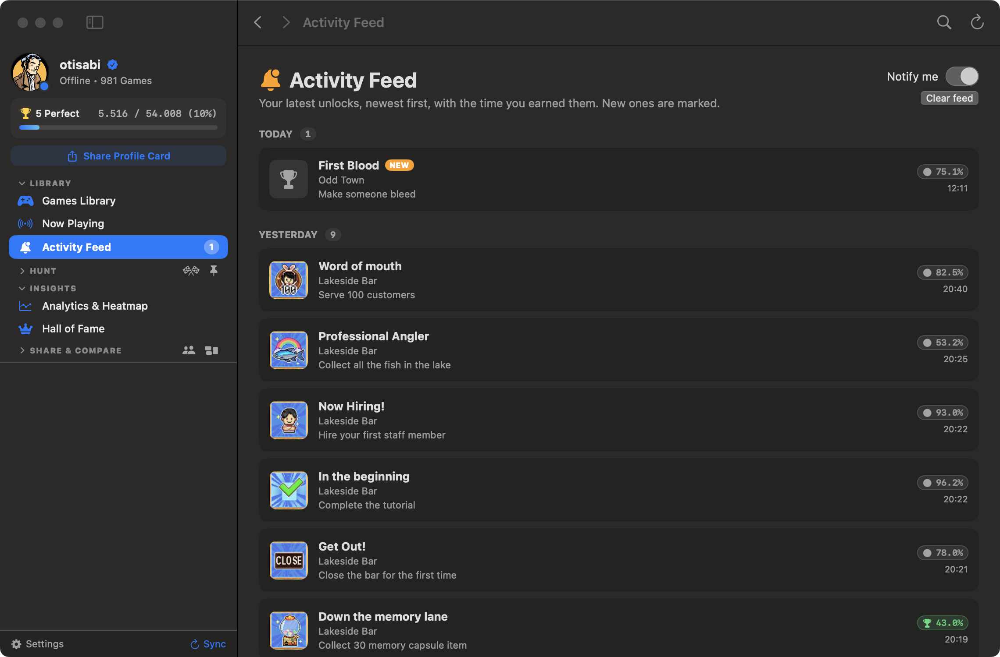
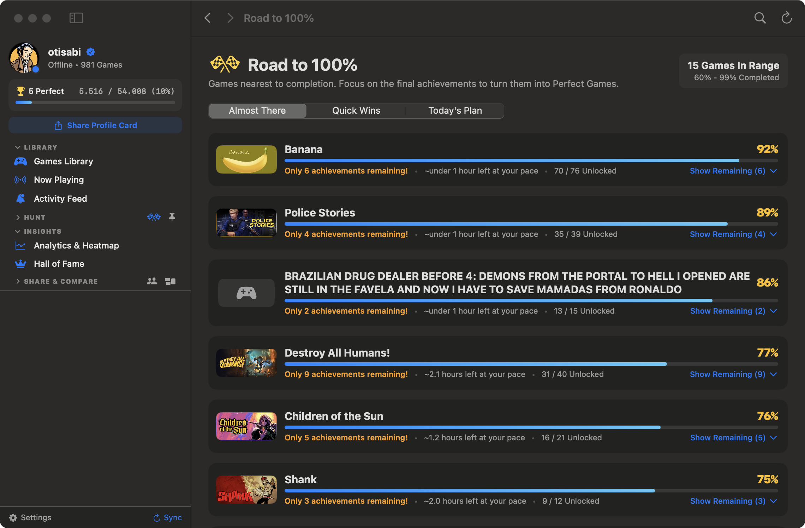
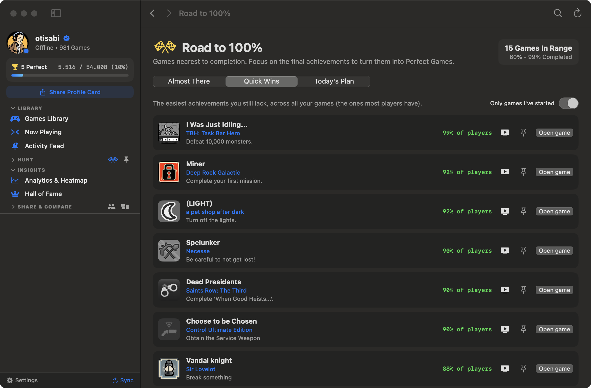
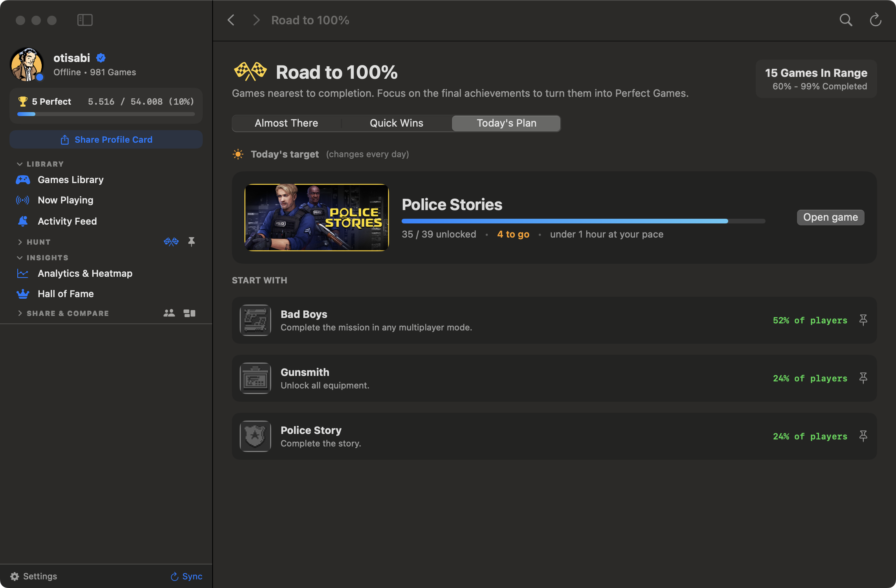
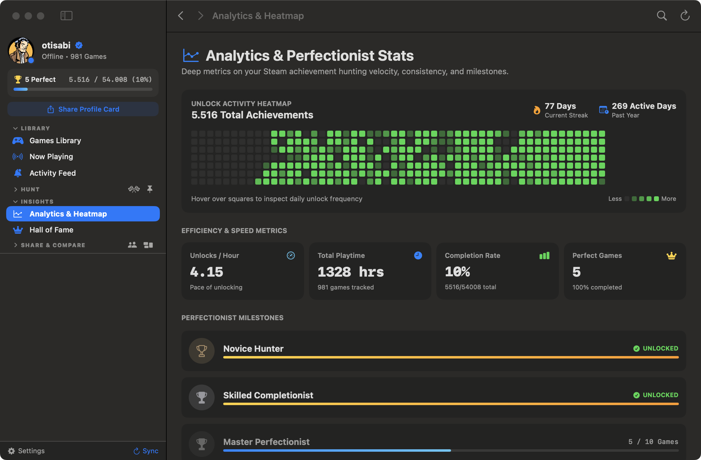
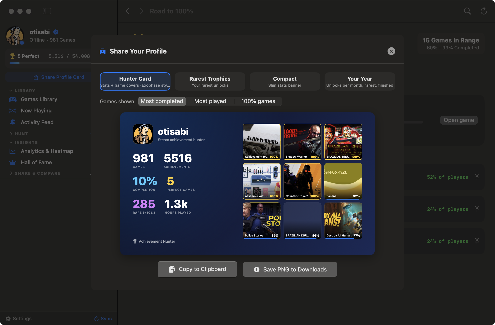
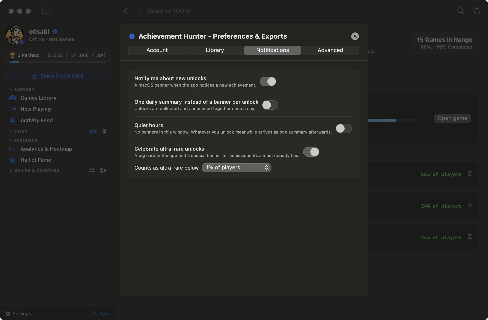

<p align="center"></p>

<p align="center">
A native macOS app (Swift, SwiftUI) to track every Steam achievement: what's left, what's easiest, what to do today.<br>
Sign in through Steam's own page. <b>No API key needed.</b>
</p>

> Looking for the Windows version? It lives in its own repository: *achievement-hunter-windows*.

## Download

Get **`AchievementHunter-1.0.0-macOS.dmg`** from the [Releases](../../releases/latest) page, open it and drag the app to Applications. Needs macOS 14 or newer.

The app is not code-signed: the first time, right-click it and choose **Open**.

## Features

- **Library** of every game with achievements, progress, search, per-achievement rarity, and Steam's new achievement sets (DLC) handled correctly.
- **Road to 100%**: *Almost There* games with a rough "hours left at your pace", *Quick Wins* (the easiest locked achievements across all your games), and a *Today's Plan* that picks one game to finish each day.
- **Now Playing**: your live Steam status and the game's remaining achievements.
- **Activity feed**: your last 5 days of unlocks, 10 per day, with "show more".
- **Friends**: favorites with live status, alerts for rare unlocks or finished games you also own, compare up to 4 friends.
- **Share cards**: per-achievement and per-game cards, a profile card, and a "Your Year" recap card.
- **Notifications**: quiet hours, a daily summary instead of a banner per unlock, and a big celebration for ultra-rare unlocks.
- **Analytics & heatmap**, Hall of Fame, widgets studio, Markdown/CSV export.
- **Automatic background sync** (every 10 minutes by default) and an instant-launch local cache.

More detail: [docs/MACOS_FEATURES.md](docs/MACOS_FEATURES.md).

## Screenshots

Taken from the running app on a real library.

| | |
|---|---|
|  |  |
|  |  |
|  |  |
|  |  |

## Privacy

- You sign in on Steam's own page inside the app; the app never sees your password.
- A short-lived Steam web token and your achievement data are stored locally on your Mac. Nothing is sent anywhere except to Steam.
- Signing out deletes the saved login.

## Build from source

Needs Xcode's command-line tools.

```bash
./scripts/run_tests.sh   # automated checks
./scripts/build.sh       # builds build/Achievement Hunter.app and AchievementHunter.dmg
```

```
Sources/    app (Swift, SwiftUI)         Tests/      test harness
scripts/    build, icon and DMG scripts  Resources/  app icon, Info.plist
docs/       banner, screenshots, feature details
```

## License

MIT, see [LICENSE](LICENSE). Not affiliated with Valve or Steam. Steam is a trademark of Valve Corporation.
